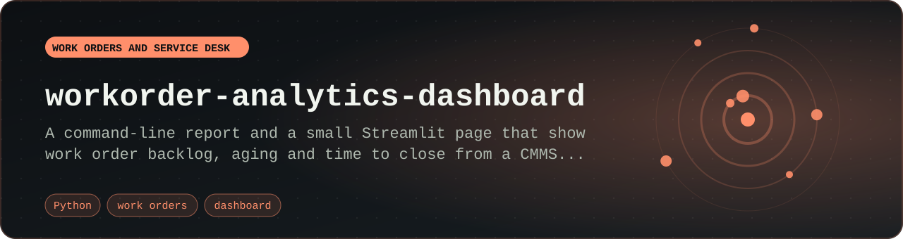
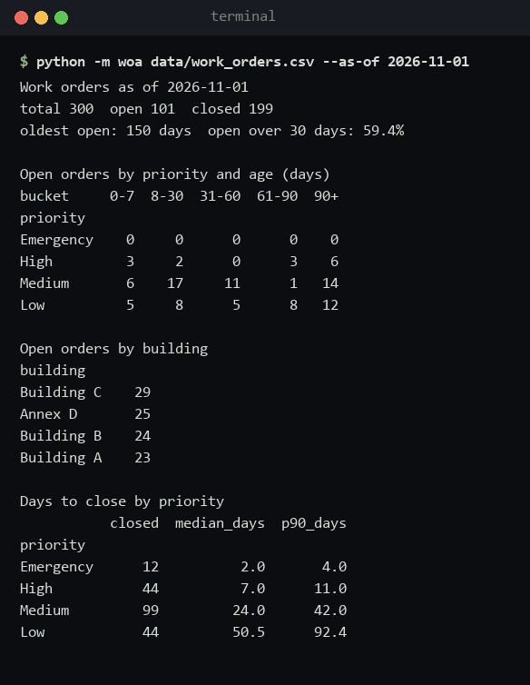

<p align="center"></p>

# workorder-analytics-dashboard

A command-line report and a small Streamlit page that show work order backlog, aging and time to close from a CMMS export.



## What it is for

Facility teams export work orders from a CMMS (computerized maintenance management system) and then answer the same questions by hand: how many are open, how old are they, which building holds the backlog, and how long does each priority take to close. Facility managers, maintenance planners and work order coordinators get those numbers from one command, or from a Streamlit page with a building filter. The sample data is synthetic.

## Install

```
git clone <this repository> && cd workorder-analytics-dashboard
python -m pip install -r requirements.txt
python -m pip install -e .
```

## How to use

| I want to | Command |
|---|---|
| Print the backlog, aging and time-to-close report, using today's date | `python -m woa data/work_orders.csv` |
| Print the report for a fixed date, so the result repeats (YYYY-MM-DD) | `python -m woa data/work_orders.csv --as-of 2026-11-01` |
| Open the dashboard page with the building filter | `streamlit run src/woa/app.py -- data/work_orders.csv` |
| Rebuild the synthetic sample file | `python examples/make_sample_data.py` |

The screenshot shows the command line report. The Streamlit page shows the same metrics and is not pictured.

Worked example:

```
python -m woa data/work_orders.csv --as-of 2026-11-01
```

Output:

```
Work orders as of 2026-11-01
total 300  open 101  closed 199
oldest open: 150 days  open over 30 days: 59.4%

Open orders by priority and age (days)
bucket     0-7  8-30  31-60  61-90  90+
priority                               
Emergency    0     0      0      0    0
High         3     2      0      3    6
Medium       6    17     11      1   14
Low          5     8      5      8   12

Open orders by building
building
Building C    29
Annex D       25
Building B    24
Building A    23

Days to close by priority
           closed  median_days  p90_days
priority                                
Emergency      12          2.0       4.0
High           44          7.0      11.0
Medium         99         24.0      42.0
Low            44         50.5      92.4
```

## How it works

- `load_work_orders` reads every column as text, checks the required columns, and parses `created` and `closed` as `YYYY-MM-DD`. A bad date raises an error that names the row.
- An order is open when it has no closed date and its status is not `Closed`.
- Age is the report date minus the created date. Ages fall into the buckets 0-7, 8-30, 31-60, 61-90 and 90+ days.
- `aging_table` crosses priority with bucket for open orders only.
- `backlog_by` counts open orders by any column, for example building or trade.
- `closure_stats` gives the median and 90th percentile days to close for closed orders, by priority.
- The report date is a parameter, so the same file always gives the same result.

## Limits

- One CSV layout with fixed column names (see `data/work_orders.csv`). It does not map other CMMS exports.
- Dates must be ISO format. Use a cleaner first if your export has mixed formats.
- Age is calendar days, not business days. There are no SLA targets.
- The Streamlit page has one filter (building) and is not tested beyond a start-up check.

## License

MIT. Yassine Emhamed, 2026.
